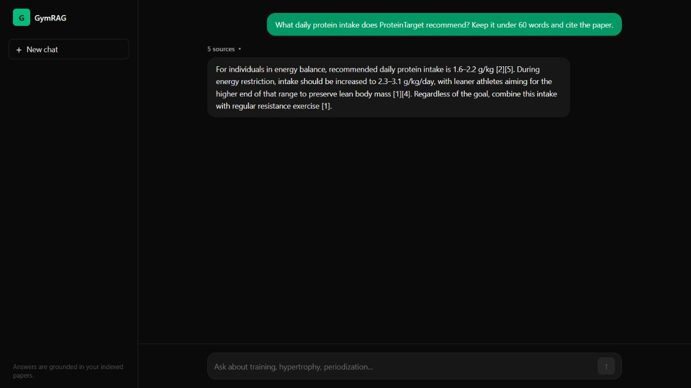
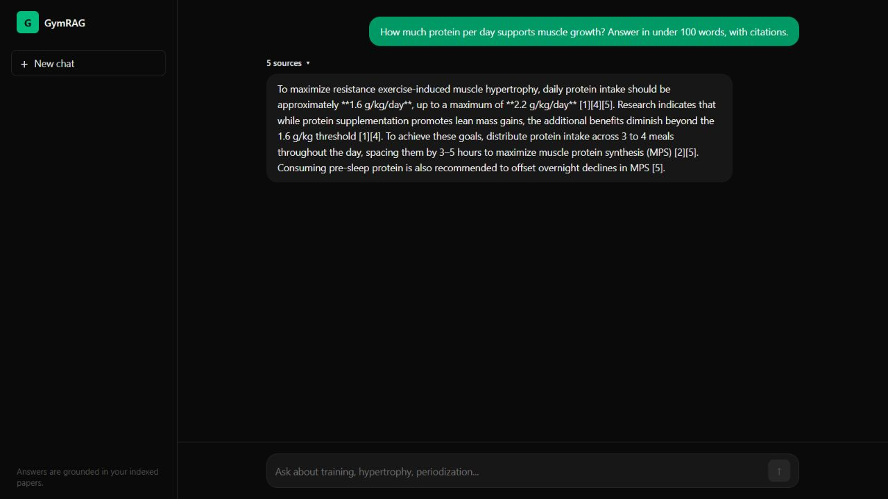
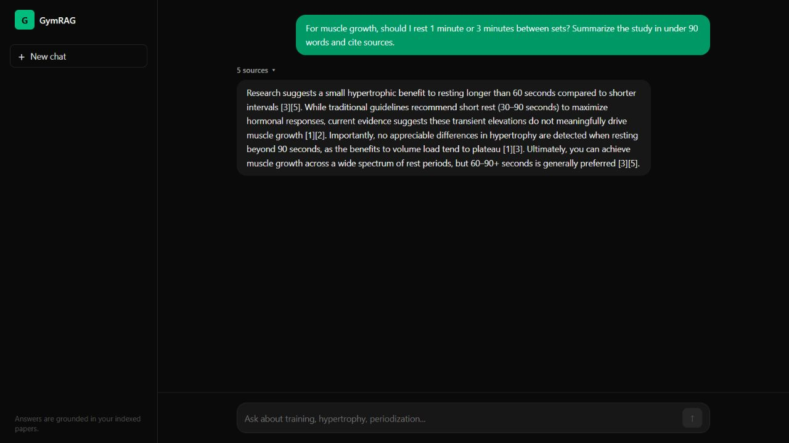
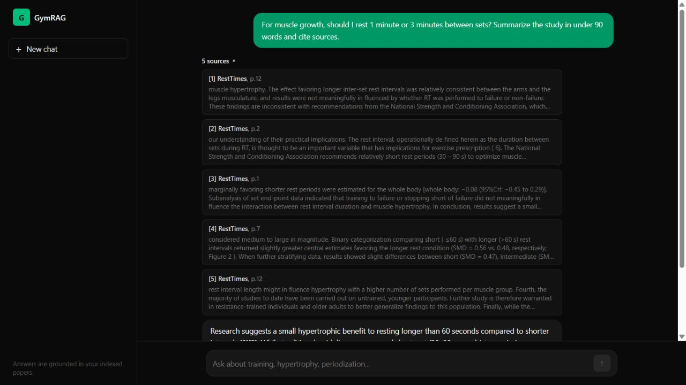

# GymRAG

[Live app](https://gymrag.onrender.com/)

A chat app that answers strength-training questions using seven research PDFs. Answers include citations and the retrieved excerpts.

React, TypeScript, FastAPI, Chroma, Cohere, and Gemini.

## Screenshots

The first screenshot is from the Render deployment. The others are from local runs. All show real provider responses, captured October 11, 2026.






## Run locally

Requires Python 3.11, Node 24, and [uv](https://docs.astral.sh/uv/).

```bash
cd backend
uv sync --locked
cp .envexample .env
# Add GEMINI_API_KEY and COHERE_API_KEY to .env.
uv run python -m scripts.ingest_papers
uv run uvicorn app.main:app --host 127.0.0.1 --port 8000
```

In another terminal:

```bash
cd frontend
npm ci
npm run dev
```

On PowerShell, use `Copy-Item .envexample .env`. Open the Vite URL. Ingestion calls Cohere and pauses between papers.

## Checks

```bash
cd backend
uv run python -m unittest discover -s tests -v
uv run python -m eval.run_eval
cd ../frontend
npm test
npm run build
```

10 backend and 23 frontend tests pass. Tests mock provider calls. The 25-question evaluation checks retrieval, not answer accuracy.

## Hosting and limits

`render.yaml` builds the frontend and API as one free service. Add the provider keys as Render secrets. Startup restores the [bundled 622-chunk index](backend/deployment/README.md); public ingestion is disabled.

Free hosting sleeps when idle and can take about a minute to wake up. Gemini can return temporary capacity errors. The old Railway deployment expired; use the live link above.

For a separate frontend, set `VITE_API_URL` to the backend origin and `CORS_ORIGINS` to the frontend origin. The client adds `/api/chat` and accepts an existing `/api` suffix.

The PDFs cover a limited set of topics. Citations do not guarantee a correct answer. Rebuild the index when replacing papers: reingestion does not remove old chunks.
